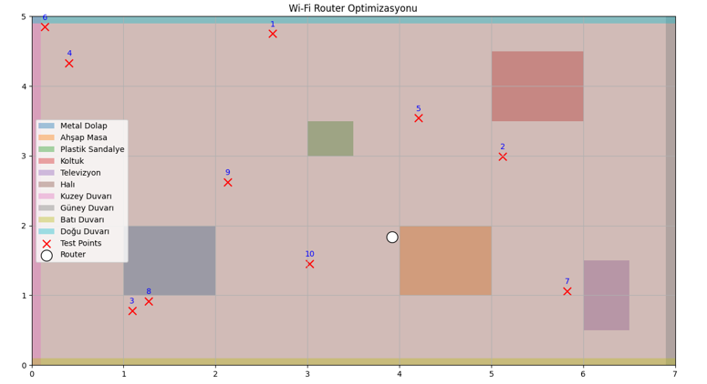
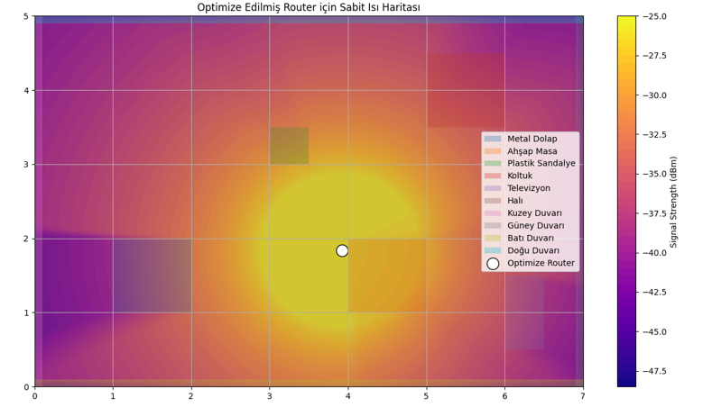
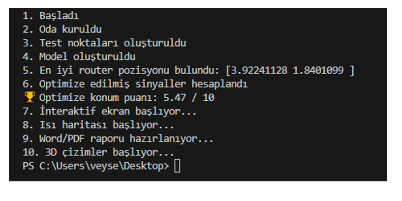
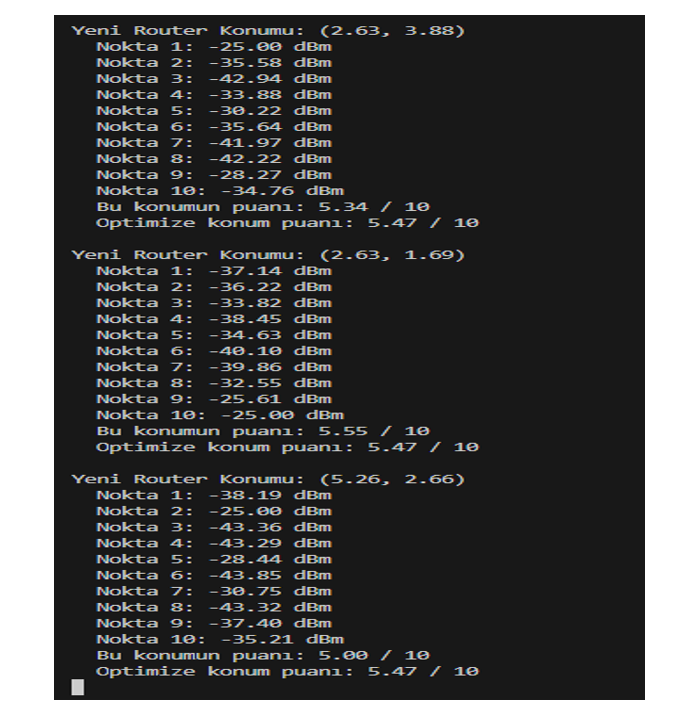
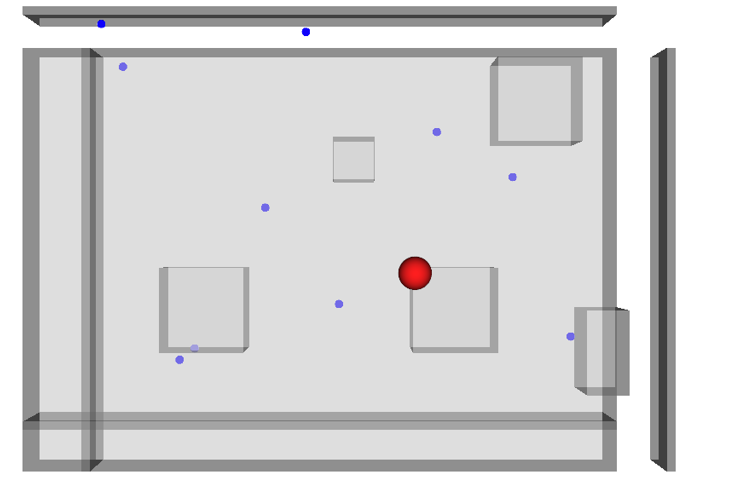
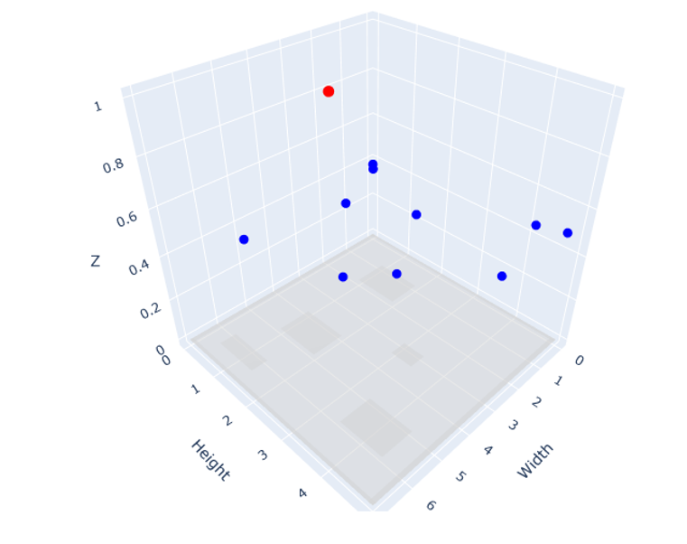

# 🚀 Smart Wi-Fi Coverage Optimization (BSc Graduation Project)

[](https://www.python.org/)
[](LICENSE)
[](https://www.mersin.edu.tr/)

An advanced indoor Wi-Fi signal coverage optimization system developed as a Bachelor's Graduation Project at Mersin University, Department of Electrical and Electronics Engineering.

---

## 📌 Project Overview
Random router placement in indoor environments often leads to signal degradation, dead zones, and connection instability. This project introduces an automated optimization framework in Python that models physical obstructions (walls, furniture, metal cabinets) and calculates the optimal placement for a Wi-Fi router to achieve maximum signal strength and homogeneity.

---

## 🛠️ Key Features & Technologies
- **Geometric Environment Modeling:** Utilizes the `Shapely` library to model indoor layouts and calculate signal attenuation based on obstacle intersection lengths.
- **Mathematical Optimization:** Implements custom utility score functions combining mean signal strength, standard deviation, and threshold penalties, optimized via `SciPy`.
- **Multi-Library 3D & 2D Visualizations:** Generates 2D heatmaps (`Matplotlib`) and interactive 3D visualizations (`Open3D`, `Plotly`, `PyVista`, `Vedo`).
- **Automated Reporting:** Automatically exports evaluation results and point-by-point signal metrics into Word (`.docx`) and PDF formats.
- **Interactive Interface:** Allows users to manually reposition the router and evaluate real-time performance scores.

---

## 📁 Repository Structure

```text
Smart-Wi-Fi-Coverage-Optimization/
│
├── src/
│   └── wifi_optimization.py       # Main Python optimization script
├── reports/
│   ├── wifi_report.docx           # Automated Word evaluation report
│   └── wifi_report.pdf            # Automated PDF evaluation report
├── Assets/
│   └── heatmap.png                # Signal strength heatmap
├── index.html                     # GitHub Pages portfolio website
└── README.md                      # Project documentation
```

---

## 📸 Proje Çıktıları ve Görselleştirmeler

Projeden elde edilen 3D ortam modellemeleri, sinyal ısı haritaları ve optimizasyon sonuçları aşağıda sunulmuştur:

| Sistem Çıktıları ve Isı Haritası | 3D Ortam Simülasyonu |
|:---:|:---:|
|  |  |
|  |  |
|  |  |

<p align="center">
  <b>Advanced 3D Ray-Tracing & Obstacle Interaction</b><br>
  
</p>

---

## 📊 Proje Posteri

